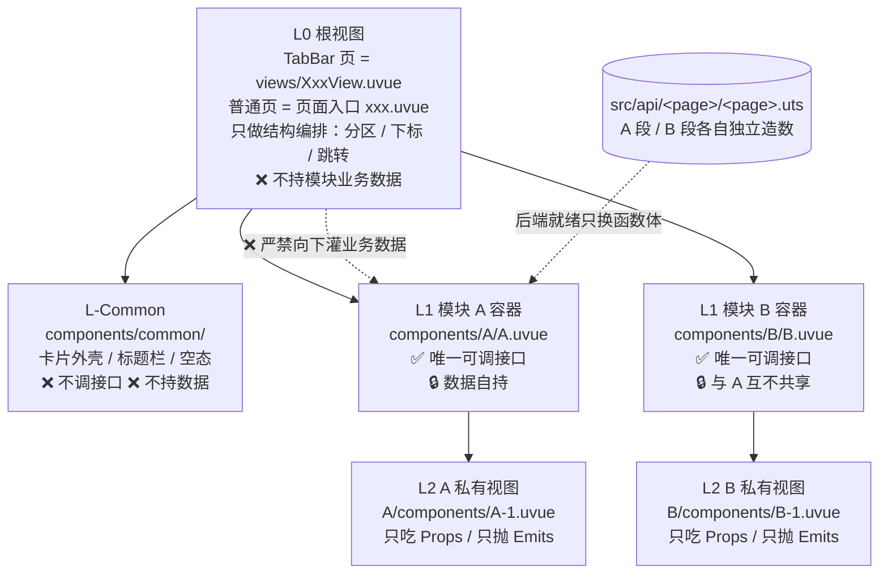

# 5 页面结构编排标准（分层 · 目录拓扑 · 拆分 · 数据归属）

> **本文件是 `unibestX-skill` 的参考分册**，由 [SKILL.md](../SKILL.md) 按需引用。
>
> **何时读本文件**：**规划一个页面的结构**时 —— 目录怎么摆、`views/` 要不要、组件拆几层、每个文件归谁管、谁可以取数、mock 与接口层落在哪。
>
> **本分册只管结构编排，不管代码怎么写**：页面文件本身怎么写（骨架 / `definePage` / 请求）→ **分册 4**；组件文件本身怎么写（props / emits / expose）→ **分册 4.5**；接口函数内部怎么写 → **分册 6**。
>
> **30 秒速记**：根视图只装结构不取数 → 模块容器自己取数 → 私有视图只吃 Props → `common/` 只做展示 → 数据全在 `src/api/<page>/` → 三级封顶、单文件 500 行。

---

## 5.1 分层结构



> **一句话**：根视图只管「装」和「切」，模块自己管「数」和「取」，`common` 只管「长什么样」。

| 层级 | 目录 / 文件 | 职责 | 能调接口 | 能持模块数据 |
| :--- | :--- | :--- | :--- | :--- |
| **L0 根视图** | TabBar 页 = `views/XxxView.uvue`；普通页 = 页面入口 | 结构编排：分区 / 下标 / 跳转 | ❌ | ❌（只持结构级状态） |
| **L-Common** | `components/common/*.uvue` | 页面内复用的纯展示外壳 | ❌ | ❌ |
| **L1 模块容器** | `components/<模块>/<模块>.uvue` | 模块唯一决策中心：取数 / loading / 分页 / 筛选 | ✅ **唯一允许** | ✅ 只持本模块的 |
| **L2 私有视图** | `components/<模块>/components/*.uvue` | 纯展示 | ❌ | ❌ |
| **Data 层** | `src/api/<page>/`（`<page>.uts` + `types.uts` + `mock/`） | 契约类型 + mock 数据集 + 接口函数 | —— 它本身是接口 | ✅ 只持本模块的 mock |

---

## 5.2 八大铁律

### 铁律 1：页面高内聚、自包含

- 页面业务组件**必须内聚在当前页面自己的 `components/` 下**；严禁跨页面借用（如在 `src/pages/index/` 引用 `src/pages/mall/components/`）。
- 只有**跨 3 个以上页面完全无差别复用**，才评估提升到 `src/components/`。
- **引用路径**：页面目录内部用相对路径（`./components/X.uvue`）；**页面目录之外一律 `@/src/...`**，包括 `src/api/**`（哪怕它对应本页）。路径写错在 UTS / Vite 侧可能静默，运行期才暴露。

### 铁律 2：三级封顶，单文件 500 行

- 层级**最多 3 级**：页面入口 → 模块容器 → 私有叶子视图。**叶子下方严禁再开 `components/`**。
- **单文件硬上限 500 行**（`template + script + style` 全算，`wc -l` 口径）；400~500 行是预警区。
- 超了**只能向下拆**（拆 L2 私有视图，或把纯逻辑抽到同目录 `.uts`）；严禁为了压行数挪去新页面或跨页面公共组件。
- 单个 `.uts` / `.ts` 同样 500 行上限，超了按功能域拆兄弟文件。⚠️ **抽 `types.uts` 不算减行手段**（类型只占 0~13%，抽不抽只看是否被多处共用）。

### 铁律 3：容器与展示视图严格分离

- **L1 容器**：模块的唯一决策中心，唯一允许调接口、持局部状态、向下分发数据、向上接事件。
- **L2 私有视图**：只做视图，**严禁调接口与异步请求**，只吃 Props、只抛 Emits。
- **L-Common**：仅在本页内被多模块复用的外壳，不做业务逻辑、不绑定业务模型。
- **Props 收敛**：容器给私有视图传参时**优先只传一个数据对象**，严禁把同一业务对象的字段摊成一串散参数；结构级意图（`:activeId`、`:maxCount`）可单独声明；全局态（主题 / 语言）由叶子直读 store，**不传**。

### 铁律 4：数据所有权下沉

- **L0 根视图只持「结构级状态」**：分区下标、swiper 锁、下拉信号、主题色、导航跳转 —— 共性是「描述页面长什么样」。
- **L0 严禁持模块业务数据**：不 `ref` 任何模块的 `list` / `loading` / `page` / `hasMore` / 筛选条件 / 选中项，不替模块 `fetch`、不分页累加、不缓存。
- **模块之间严禁共享数据与状态**：A 的数据只属于 A；跨模块联动**只传结构级意图**（切分区 / 跳转），由根视图承接转发，不携带业务数据。

### 铁律 5：Mock 与接口层落位

- 页面目录（`src/pages/<page>/`、`src/sub/<page>/`）下**严禁出现 `mock.uts`**。
- 模拟数据集与接口函数**同层收拢**在 `src/api/<page>/`：

  ```text
  src/api/<page>/
  ├── <page>.uts     # ★ 必须：接口函数，按模块用注释分段
  ├── types.uts      # 契约类型叶子文件（只放 type）
  └── mock/          # 数据集，一模块一文件，各自 export MOCK_*
  ```

- **新增页面必须在同一次改动里建出接口层**；页面里每一块将来由后端下发的数据，都要能顺到某个 `fetchXxx()`，否则视为未交付。
- 数据集与接口函数**按模块独立**：A 段的数组不得被 B 段取用，严禁抽一个「通用 `fetchList(type)`」。
- 接口层内部怎么写（命名 / 契约类型 / 造数 / http）→ **分册 6**。

### 铁律 6：注释只落三处

1. 组件文件顶部一句用途；
2. 模板里每个自定义组件与功能块上方一句；
3. 脚本里**每组状态与其方法**上方一句，具名函数用 JSDoc。

组内变量一律不写注释（靠语义化命名 + 类型标注自解释）；严禁逐行注释；只写「为什么」，不写「做了什么」。

### 铁律 7：生态优先

`src/utils/` 与 `uni_modules/` 里已有能力的，**绝对优先复用**，严禁手写重复实现。具体清单与「该用谁」→ **分册 7**。

### 铁律 8：可读性优先

循环与 `if` 嵌套各不超两层、单处分支不超 3 个；复杂条件抽成具名布尔函数；相似逻辑出现两遍立刻抽函数。
⚠️ 抽函数与调顺序必须同时满足「函数定义先于调用点」，冲突时以编译通过为准（分册 1.15）。

---

## 5.3 目录拓扑

### 1. 先判定页面形态：要不要 `views/`

| 页面形态 | 位置 | 入口 `.uvue` 的角色 | 要 `views/` 吗 |
| :--- | :--- | :--- | :--- |
| **TabBar 页面** | `src/pages/<page>/` | **薄壳**：`definePage` + Tab 联动 + 生命周期 | ✅ **要**，真正的 L0 是 `views/XxxView.uvue` |
| **普通页面（简单）** | `src/sub/**` 等 | **就是 L0 根视图** | ❌ 不要 |
| **普通页面（复杂）** | `src/sub/**` 等 | **就是 L0 根视图**，编排模块容器 | ❌ 不要（其余规则与 TabBar 页相同） |

> `views/` 是 **TabBar 页面的专属产物**（它被 `TabViews.uvue` 承载）；普通页入口自己就是根视图。

### 2. 普通页面目录树（默认形态，`src/sub/**` 与单页）

**普通页没有 `views/`**，入口 `.uvue` 本身就是 L0 根视图。以 `src/sub/order-list/` 为例：

```text
src/
├── api/                              # 全局接口层（页面目录之外）
│   └── order-list/                   # 目录名 = 页面目录名
│       ├── order-list.uts            # ★ 接口函数，按模块分段
│       ├── types.uts                 # 契约类型（只放 type）
│       └── mock/                     # 一模块一文件的数据集
│
└── sub/
    └── order-list/
        ├── order-list.uvue           # ★ L0 根视图（入口即根视图，无薄壳）
        ├── types.uts                 # 页面 UI 层类型（后端 DTO 在 src/api/）
        └── components/               # 页面内聚组件根（严禁对外暴露）
            ├── common/               # L-Common 纯展示外壳
            ├── order/                # L1 模块「订单」
            │   ├── OrderModule.uvue  #   取数 / loading / 分页，数据自持
            │   └── components/       # L2 模块私有视图
            │       ├── OrderCell.uvue
            │       └── OrderEmpty.uvue
            └── coupon/               # L1 模块「优惠券」（与 order 互不共享）
                ├── CouponModule.uvue
                └── components/
```

- **简单普通页可以更扁**：不拆模块时，`components/` 下直接平铺 `XxxCard.uvue`，不必建「模块/模块.uvue」两级（见第 5 节豁免）。
- **入口文件的位置**：`src/sub/<page>/<page>.uvue`，与目录同名。

### 3. TabBar 页面目录树（`src/pages/**`）

**TabBar 页多一层薄壳 + `views/`**：入口只负责 `definePage` 与 Tab 联动，真正的 L0 根视图在 `views/`。以 `src/pages/index/` 为例：

```text
src/
├── api/                              # 全局接口层（页面目录之外）
│   └── index/                        # 目录名 = 页面目录名
│       ├── index.uts                 # ★ 接口函数，按模块分段
│       ├── types.uts                 # 契约类型（只放 type）
│       └── mock/                     # 一模块一文件的数据集
│
└── pages/
    └── index/
        ├── index.uvue                # ★ 薄壳：definePage + Tab 联动 + 生命周期，模板只有一行 <IndexView />
        ├── types.uts                 # 页面 UI 层类型（后端 DTO 在 src/api/）
        ├── views/                    # ★ 仅 TabBar 页有：真正的 L0 根视图
        │   └── IndexView.uvue        #   只做结构编排（分区 / 下标 / 跳转）
        └── components/               # 页面内聚组件根（严禁对外暴露）
            ├── common/               # L-Common 纯展示外壳
            ├── A/                    # L1 模块 A
            │   ├── A.uvue            #   取数 / loading / 分页，数据自持
            │   └── components/       # L2 模块 A 私有视图
            └── B/                    # L1 模块 B（与 A 互不共享）
                ├── B.uvue
                └── components/
```

**两张树的唯一差别**：

| | 普通页（第 2 节） | TabBar 页（第 3 节） |
| :--- | :--- | :--- |
| 入口 `.uvue` | **就是 L0 根视图** | **薄壳**（只写 `definePage` + Tab 联动） |
| `views/` | ❌ 不要 | ✅ **必须有** |
| 模块 / 公共组件结构 | 完全相同 | 完全相同 |

**读写关系**（两张树通用）：

```text
✅ A.uvue ──调自己那段──> @/src/api/<page>/<page>.uts
✅ A.uvue ──Props 下灌──> A-1.uvue ──Emits 上抛──> A.uvue
✅ A / B ──复用纯 UI 外壳──> components/common/
✅ 根视图 ──只传结构级意图（切分区 / 跳转）──> A / B
❌ 根视图 ──持 A 的 list / loading / 分页──> A
❌ B ──读写 A 的状态 / 复用 A 的 mock 与 fetch──> A
❌ components/common/ ──调接口 / 持业务数据──> 任何模块
```

### 4. 组件放哪（目录视角）

| 位置 | 谁用 | 引用方式 | 命名 |
| :--- | :--- | :--- | :--- |
| `uni_modules/<lib>/components/<name>/<name>.uvue` | 全项目 | **easycom 自动** | 库规定 |
| `src/components/<Name>/<Name>.uvue` | 全项目（3+ 页面才提升） | **easycom 自动** | 目录与文件**同名 PascalCase** |
| `src/pages/<page>/components/`、`src/sub/<page>/components/` | 仅本页 | **必须手动 `import`** | PascalCase |

> 组件的**写法**（props / emits / expose / 根节点）见分册 4.5；本节只定位置。

### 5. 两个形态豁免

- **模块容器允许不带子目录**：模块只有一个 UI 块时，`components/<模块>/<模块>.uvue` 本身就是 L1 叶子，不必硬拆 L2。
- **扁平形态合法**：页面只有一个业务块、或各块彼此独立且很薄时，可直接 `components/Xxx.uvue` 平铺 —— **但铁律不倒**：谁持数据、谁调接口必须唯一且不共享。
- **简单页面极简形态**：如 `src/sub/auth/login.uvue` 不拆模块，入口 = 根视图 + 若干 UI 组件。**禁止**为了「对齐规范」硬造 `views/` 或空壳模块容器；一旦出现多个互不相干的业务数据块，就按复杂页拆。

---

## 5.4 结构速查

| 我现在要决定的事 | 答案 |
| :--- | :--- |
| 要不要建 `views/`？ | 只有 **TabBar 页面**要 |
| 复杂页怎么拆？ | L0 根视图 → L1 模块容器 → L2 私有视图，最多三级 |
| 组件放哪？ | 页面内聚在 `components/`；3+ 页面无差别复用才进 `src/components/` |
| 谁能调接口？ | **只有 L1 模块容器** |
| 根视图能持什么？ | 只持结构级状态（分区 / 下标 / 跳转） |
| 模块之间能共享数据吗？ | 不能，只能传结构级意图 |
| mock 放哪？ | `src/api/<page>/mock/<模块>.uts`；页面目录下严禁 `mock.uts` |
| 文件多大要拆？ | 单文件 > 500 行必须拆，只能向下拆 |

---

## 5.5 自检红线清单（结构）

- [ ] **1. 页面内聚** —— 没有跨页面借用业务组件；3+ 页面无差别复用才进 `src/components/`
- [ ] **2. 路径规范** —— 页面目录内用相对路径，目录外一律 `@/src/...`（含 `src/api/`）
- [ ] **3. 层级 ≤ 3 级** —— 叶子视图下不再开 `components/`
- [ ] **4. 单文件 ≤ 500 行** —— 超了向下拆；`types.uts` 不算减行手段
- [ ] **5. 只有 L1 调接口** —— L0 / L2 / `common/` 都不取数
- [ ] **6. 根视图不持模块数据** —— 只持结构级状态
- [ ] **7. 模块之间零共享** —— 数据、loading、分页、mock、fetch 都只属于自己
- [ ] **8. Props 收敛** —— 一个子视图一个数据对象，不摊平字段；全局态不传
- [ ] **9. 接口层同批建出** —— `src/api/<page>/<page>.uts` 与页面目录逐字同名
- [ ] **10. 页面目录无 `mock.uts`** —— 数据集进 `src/api/<page>/mock/`
- [ ] **11. 形态判定过** —— TabBar 页有 `views/`，普通页没有；简单页不硬拆
