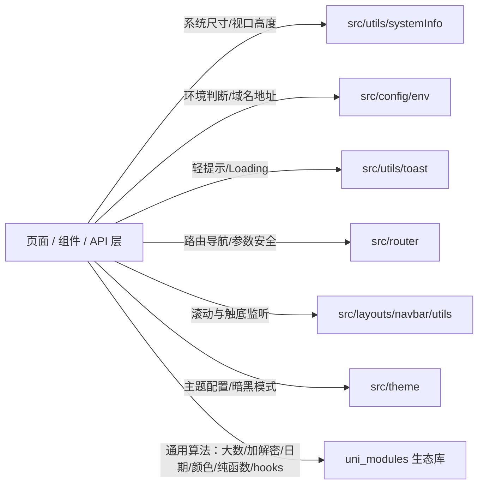

# 8 项目核心工具库使用规范（系统信息 · 环境变量 · 生态工具库优先 · 通用工具优先原则）

> **本文件是 `unibestX-skill` 的参考分册**，由 [SKILL.md](../SKILL.md) 按需引用。
>
> **何时读本文件**：
>
> - 获取屏幕尺寸、视口高度、状态栏高度、安全区、导航栏高度、TabBar 高度时；
> - 判断当前运行环境（开发/生产/测试）、获取 API 基础请求地址、OSS 配置、当前编译平台或 Vapor 模式时；
> - 使用轻提示（Toast）、加载动画（Loading）、路由跳转与参数传递、滚动监听、主题切换等通用能力时；
> - **需要数学运算（大数 / 精度）、加解密与哈希、日期时间处理、颜色转换、数组与对象工具函数、组合式 hooks（倒计时 / 验证码 / 定时器 / 层级管理）时** —— 先查 `uni_modules/` 生态库（见 8.5）；
> - 编写任何页面、组件或业务模块，准备手写底层原生 API 前 —— **必须首先阅读并优先使用 `src/utils/` 中的封装工具**。
>
> **核心铁律**：**严禁重复造轮子，严禁在业务层散落原生硬编码**。系统信息优先使用 `@/src/utils/systemInfo`，环境变量优先使用 `@/src/config/env`，通用算法能力优先复用 `uni_modules/` 下的生态库（见 8.5），开发中所需的基础通用能力优先检索并使用 `@/src/utils/...`。

---

## 8.1 总原则：工具库优先（Utils-First Principle）

在 uni-app X 跨端原生架构中，底层映射为 Android Kotlin、iOS Swift、鸿蒙 ArkTS 与 Web/小程序。直接在业务页面中调用零散原生 API 存在严重隐患：

1. **多端行为与单位不一致**：原生安卓、iOS 与鸿蒙在状态栏高度、胶囊对齐、底部安全区的表现存在细微差异；
2. **重复调用损耗性能**：频繁同步调用 `uni.getSystemInfoSync()` 会触发原生跨语言桥接，损耗帧率与响应速度；
3. **环境硬编码难以维护**：原生端不存在浏览器 `window` 或 Node `process.env`，散落书写的域名与配置在切换多环境时极易遗漏；
4. **统一封装已具备响应式与兜底**：`src/utils/` 中的核心模块已通过 Vue 响应式计算属性（`computed` / `ref`）做好了强类型封装与全平台兜底。



---

## 8.2 系统信息模块：`src/utils/systemInfo`

### 8.2.1 核心导出与推荐用法

| 导出符号 | 类型 | 说明与典型使用场景 |
| :--- | :--- | :--- |
| `statusBarHeight` | `ComputedRef<number>` | 状态栏高度（px）。自定义导航栏占位、顶部安全避让。 |
| `navBarHeight` | `ComputedRef<number>` | 导航栏内容区高度（px，标准 44px）。 |
| `tabBarHeight` | `ComputedRef<number>` | TabBar 高度（px，标准 50px）。 |
| `availableHeight` | `ComputedRef<number>` | **内容可用区高度（px）**。已自动扣除状态栏、导航栏与 TabBar（根据当前布局与 TabBar 策略自动计算）。页面固定容器直接绑定 `:style="{ height: availableHeight + 'px' }"`。 |
| `safeAreaBottom` | `ComputedRef<number>` | 底部安全区边距（px）。用于底部操作条、固定按钮避让全面屏黑条。 |
| `safeAreaInsets` | `Ref<SystemSafeAreaInsets &#124; null>` | 四周安全区对象（top, right, bottom, left）。 |
| `windowWidth` / `windowHeight` | `ComputedRef<number>` | 窗口可视宽高（px）。 |
| `screenWidth` / `screenHeight` | `ComputedRef<number>` | 物理屏幕宽高（px）。 |
| `menuRect` | `ComputedRef<SystemMenuRect &#124; null>` | 微信小程序右上角胶囊布局信息（px），其他平台为 null。 |
| `systemInfo` | `Ref<SystemInfoType &#124; null>` | 全量响应式系统信息实体。 |
| `sys` / `systemUtils` | `SystemUtils` 单例 | 系统信息工具单例，提供 `isAndroid()`、`isIOS()`、`isHarmony()`、`updateSystemInfo()` 等方法。 |
| `getScrollHeight()` | `(topPadding?: number, bottomPadding?: number) => number` | 计算特定局部滚动容器的安全高度。 |

### 8.2.2 正反例对照

```html
<!-- ❌ 错误做法：在页面中自行调用 uni API 或硬编码高度 -->
<script setup lang="uts">
// ❌ 错误 1：每次都执行同步桥接原生获取系统信息，性能低且非响应式
const sys = uni.getSystemInfoSync();
const topBar = sys.statusBarHeight + 44;

// ❌ 错误 2：样式中手写 100vh 或硬算视口高度，原生端不支持 vh 且底部会被 TabBar 遮挡
</script>
<template>
  <view style="height: 100vh;"></view>
</template>

<!-- ✅ 正确做法：直接按需引入 src/utils/systemInfo 导出的响应式变量 -->
<script setup lang="uts">
import { computed } from 'vue';
import {
  availableHeight,
  statusBarHeight,
  navBarHeight,
  safeAreaBottom
} from '@/src/utils/systemInfo/index.uts';

// 页面内部自定义滚动区高度
const contentHeight = computed((): number => availableHeight.value);
</script>

<template>
  <view class="flex flex-col flex-1" :style="{ height: `${contentHeight}px` }">
    <!-- 顶部状态栏避让占位 -->
    <view :style="{ height: `${statusBarHeight}px` }"></view>
    <!-- 内容区域 -->
    <scroll-view direction="vertical" class="flex-1">
      <!-- 列表内容 -->
    </scroll-view>
    <!-- 底部安全区占位（如有吸底固定按钮） -->
    <view :style="{ height: `${safeAreaBottom}px` }"></view>
  </view>
</template>
```

---

## 8.3 环境变量模块：`src/config/env`

### 8.3.1 核心导出与推荐用法

| 导出符号 | 类型 / 签名 | 说明与典型使用场景 |
| :--- | :--- | :--- |
| `isDev()` | `() => boolean` | 是否为本地开发环境（`development`）。 |
| `isTest()` | `() => boolean` | 是否为测试环境（`test`）。 |
| `isProd()` | `() => boolean` | 是否为生产发布环境（`production`）。 |
| `getCurrentEnv()` | `() => string` | 获取当前环境标识（`dev` / `test` / `prod`）。 |
| `getCurrentEnvName()` | `() => string` | 获取当前环境友好中文名称（如`开发环境`）。 |
| `getApiBaseUrl()` | `() => string` | **主 API 基础请求地址**（如 `https://api.example.com`）。http 请求层与页面下载直传必须使用。 |
| `getApiSecondaryUrl()` | `() => string` | 备用 / 次级 API 服务地址。 |
| `getOssBaseUrl()` | `() => string` | OSS 静态资源 CDN 根路径。 |
| `getOssUploadUrl()` | `() => string` | OSS 文件直传服务地址。 |
| `getStreamUrl()` | `() => string` | SSE 流式推送或实时通讯服务地址。 |
| `getCompilePlatform()` | `() => string` | 当前编译平台（`app-android`, `app-ios`, `app-harmony`, `h5`, `mp-weixin` 等）。 |
| `getCompileMode()` | `() => string` | 当前渲染编译模式（`vapor` 或 `vdom`）。 |
| `isVaporMode()` | `() => boolean` | 当前是否处于 Vue 3 Vapor 模式。 |
| `getTabBarMode()` | `() => string` | 当前生效的 TabBar 模式（`native` 或 `custom`）。 |
| `isNativeTabBar()` | `() => boolean` | 当前是否为原生 TabBar 模式。 |
| `env` / `envUtils` | `EnvUtils` 单例 | 环境变量集成单例工具。 |

### 8.3.2 正反例对照

```ts
// ❌ 错误做法 1：手写 process.env 或 import.meta.env（原生 Kotlin/Swift 端无法识别或报错）
const baseUrl = process.env.VITE_SERVER_BASEURL; // ❌ 原生平台运行时可能报错或取不到

// ❌ 错误做法 2：业务代码或接口层中硬编码服务器 IP / 域名
const res = await uni.request({ url: 'http://192.168.1.100:8080/api/user/info' }); // ❌ 严禁硬编码

// ❌ 错误做法 3：手写条件编译字符串判断生产环境
// #ifdef H5
if (location.hostname !== 'localhost') { ... } // ❌ 跨端无效
// #endif

// ✅ 正确做法：统一从 @/src/config/env/env.uts 引入
import {
  getApiBaseUrl,
  getOssBaseUrl,
  isDev,
  isProd,
  getCompilePlatform
} from '@/src/config/env/env.uts';

// 获取全路径接口地址
const requestUrl = `${getApiBaseUrl()}/api/v1/goods/detail`;

// 获取 OSS 图片绝对地址
function getFullImageUrl(relativePath: string): string {
  if (relativePath.startsWith('http')) return relativePath;
  return `${getOssBaseUrl()}/${relativePath}`;
}

// 环境行为分支
if (isDev()) {
  console.log('[Dev Monitor] 当前编译平台:', getCompilePlatform());
}
```

---

## 8.4 常用通用工具库汇总（优先检索与复用）

在进行业务页面开发时，除 `systemInfo` 和 `env` 外，以下工具库位于 `@/src/utils/` 下，已全面适配 uni-app X 原生平台与强类型规范，必须优先调用：

### 8.4.1 轻提示与 Loading：`@/src/utils/toast/index.uts`

- **导出方法**：
  - `toast(message: string)`：简易黑色背景无图标轻提示，防御原生大对勾乌龙，时长 1500ms。
  - `toastSuccess(message: string)`：成功轻提示（带成功对勾图标），时长 1500ms。
  - `toastError(message: string)`：失败错误轻提示（带错误图标），时长 1500ms。
  - `showLoading(title?: string, mask?: boolean)`：全局加载中菊花遮罩，默认「加载中...」，默认带透明蒙层防重复操作。
  - `hideLoading()`：关闭加载遮罩。
- **规则**：严禁散落手写 `uni.showToast({ title: '...', icon: 'none' })`，统一使用 `toast(msg)` 或 `toastSuccess(msg)`。

### 8.4.2 路由与页面跳转：`src/router/`

- **架构定位**：采用与 `@/src/http` 镜像对称的子模块化架构（`config/`、`guard/`、`hooks/`、`interceptor/`、`toLoginPage/`、`utils/`）。
- **⚠️ 门面很窄**：`@/src/router/index.uts` **只转发四块** —— `config`、`useRoute`、`useRouter`、`interceptor`。其余符号一律**精准导入具体实现文件**（门面宽转发会让底层符号全成公共 API，调用方穿越门面引用，正撞 Kotlin `<clinit>` 循环死锁，见分册 1.22 / 红线 36）。
- **符号来源对照**：

  | 符号 | 从哪拿 |
  | :--- | :--- |
  | `useRoute()` / `useRouter()` | `@/src/router/index.uts` |
  | `cleanPath(path)`、`getCurrentPath()`、`getCurrentRoute()`、`getCurrentPageOptions()`、`getPageStackLength()`、`isSamePath(a, b)`、`parseUrlToObj(url)`、`resolveUrl(to)`、`route` / `routeUtils` 单例 | `@/src/router/utils/utils.uts` |
  | `toLoginPage(options?)`（带 1s 节流的登录重定向，自动防重复跳转自身） | `@/src/router/toLoginPage/toLoginPage.uts` |
  | `LOGIN_PAGE`、`REGISTER_PAGE`、`EXCLUDE_LOGIN_PATH_LIST`、`LOGIN_STRATEGY`、`isNeedLoginMode` | `@/src/router/config/config.uts` |
  | `routeState`、`setRouteMeta()` / `removeRouteMeta()` / `getRouteMeta()` | `@/src/router/hooks/route-state.uts` |
  | `installRouteInterceptor()`、`checkDirectEntry(options)` | `@/src/router/interceptor/interceptor.uts` |

- **规则**：跳转与取路由**必须**走组合式 hooks（`useRouter()` / `useRoute()`），严禁在页面里直接调原生导航 API —— 完整正反例与红线见**分册 9**。

### 8.4.3 Navbar 布局页面滚动监听：`@/src/layouts/navbar/utils/index.uts`

- **导出方法**：
  - `onNavbarPageScroll(callback: (e: PageScrollDetail) => void)`
  - `onNavbarReachBottom(callback: () => void)`
  - `onNavbarPullDownRefresh(callback: () => void)`
  - `stopNavbarPullDownRefresh()`
- **规则**：在采用了 `layout="navbar"` 或 `layout="default"` 的页面中，由于根容器已被布局自带的 `scroll-view` 接管，原生 `onPageScroll` / `onReachBottom` 不会被触发，**必须使用 `onNavbarPageScroll` 与 `onNavbarReachBottom`**。

### 8.4.4 主题与样式系统：`@/src/theme/index.uts`

- **导出方法**：
  - `getThemeTokens(isDark: boolean): ThemeTokens`：获取当前明暗模式下的颜色代币集合。
  - `getRootThemeStyle(themeColor: string, isDark: boolean): UTSJSONObject`：生成绑定在根容器 `:style` 上的 CSS 变量集合。
  - `applyThemeColor(color: string)`：动态注入全局主题色。

### 8.4.5 跨端「再按一次退出应用」：`@/src/utils/backPress/index.uts`

- **导出方法**：
  - `handleBackPressExit(): boolean`：双击返回退出应用的辅助函数。首次触发弹「再按一次退出应用」toast 并返回 `true`（拦截本次返回），2 秒内再次触发则退出应用并返回 `false`。Android 端先 `finishAffinity()` 播退出动画、延迟后 `System.exit(0)` 彻底杀进程，确保下次是干净冷启动。

### 8.4.6 文件上传：走 `http.upload<T>`（`@/src/http/request/request.uts`）

- **架构定位**：文件上传属于网络传输范畴，收敛在 `src/http/request/request.uts`（与 `src/http/stream/stream.uts` 的 `requestStream` 并列），全部由 `@/src/http/index.uts` 门面导出。
- **导出方法**：
  - `http.upload<T>(url: string, config: LimeRequestConfig | null): Promise<T>`：`http` 单例上的上传方法，底层走 lime-request 的 UPLOAD，自动带 token；`T` 无法从入参推断，**必须显式标注**（如 `http.upload<string>(...)`）。
  - `uploadHttp<T>(url: string, config: LimeRequestConfig | null): Promise<T>`：`http.upload<T>` 的具名函数包装，由 `@/src/http/request/request.uts` 直接导出。
  - OSS 直传地址读 `getOssUploadUrl()` / `getOssUploadPath()`（`@/src/config/env/env.uts`），**严禁硬编码**。

### 8.4.7 数据埋点与监控上报：`@/src/utils/report/index.uts`

- **导出方法**（该门面 `export *` 自 `./track.uts` 与 `./error.uts`）：
  - `track(event: string, propsJson: string = '')`：业务数据埋点上报，附加属性以 **JSON 字符串**传入（不是 `UTSJSONObject`）。
  - `reportError(err: any | null, extraMessage: string = '')`：全局错误捕获与日志监控上报。
  - `reportErrorMessage(message: string)`：按纯文本消息上报一条错误。
  - `trackPageView(page: string = '')` / `trackClick(name: string)`：页面浏览 / 点击埋点。

---

## 8.5 生态工具库优先：`uni_modules/` 下的通用能力库

### 8.5.1 三段式检索顺序（写通用能力前必走）

`src/utils/` 覆盖的是**项目专属能力**（系统信息、环境变量、Toast、路由、主题），`uni_modules/` 下的生态库覆盖的是**通用算法能力**（大数运算、加解密、日期时间、颜色处理、纯函数、组合式 hooks）。两者**互补、不重叠**，因此不是「二选一」，而是**两边都要查**：

1. **先查 `uni_modules/` 生态库**（下表 6 个）—— 生态库实现成熟、已适配全端、自带 `readme.md` 与项目内演示页；
2. **再查 `@/src/utils/` 项目封装**（见 8.2 / 8.3 / 8.4）；
3. **两处都没有，才允许自己实现**；实现后应沉淀回 `@/src/utils/` 供后续复用（见红线 10）。

> 🚫 **严禁「先把算法写出来，事后才发现生态库里本来就有」**。判断依据是**先读下表、再读该库的 `readme.md`**，不是凭印象或凭「以前没这么用过」。

### 8.5.2 六个生态工具库速查表

| 库 | 定位 | 导入入口 | 典型导出 | 项目内演示页 |
| :--- | :--- | :--- | :--- | :--- |
| `lime-shared` | 通用纯函数集合，90+ 个「一函数一文件」模块 | **必须深引入到具体函数文件**（见下方 ⚠️） | `addUnit`、`debounce`、`throttle`、`floatAdd`、`fillZero`、`raf`、`uniqid`、`isEmail` | `src/sub/limeSharedFunctionDemo/limeSharedFunctionDemo.uvue` |
| `lime-use` | Vue3 组合式函数（hooks）库 | `@/uni_modules/lime-use` | `useCountDown`、`useCodeTimer`、`useTimeout`、`useZIndex`、`useTransition`、`usePopupStack` | `src/sub/limeUseFunctionDemo/limeUseFunctionDemo.uvue` |
| `lime-color` | 颜色处理（tinycolor 的 UTS 版） | `@/uni_modules/lime-color` | `tinyColor`、`generate`、类型 `TinyColor` / `LGenerateOptions` | `src/sub/limeColorFunctionDemo/limeColorFunctionDemo.uvue` |
| `lime-dayuts` | 日期时间库（dayjs 的 UTS 移植版） | `@/uni_modules/lime-dayuts` | `dayuts`（链式 API 与 dayjs 基本一致） | `src/sub/timeFunctionDemo/timeFunctionDemo.uvue` |
| `unix-Bignumber` | 任意精度十进制运算（bignumber.js 风格） | `@/uni_modules/unix-Bignumber` | `BigNumber`、`config`、`ROUND_UP` / `ROUND_HALF_UP` 等 9 种舍入常量 | `src/sub/bignumberFunctionDemo/bignumberFunctionDemo.uvue` |
| `unix-crypto` | 加解密与安全工具（Promise 风格） | `@/uni_modules/unix-crypto` | `base64Encode` / `base64Decode`、`md5`、`sha256`、`hmacSha1`、`aesEncrypt` / `aesDecrypt`、`desEncrypt` / `desDecrypt`、`rsaEncrypt` / `rsaDecrypt` / `rsaSign` / `rsaVerify`、`generateUUID` | `src/sub/cryptoFunctionDemo/cryptoFunctionDemo.uvue` |

**选型指引**：

- **单次 / 少量浮点运算**（如 `0.1 + 0.2`）→ `lime-shared` 的 `floatAdd` / `floatSub` / `floatMul` / `floatDiv` 即可，**不必上 `unix-Bignumber`**；
- **连续多步运算、需要指定精度或舍入模式、2~36 进制、千分位格式化** → `unix-Bignumber`；
- **格式化与取值用 `lime-dayuts`，不要手写日期拼接**；涉及时区与 locale 时以该库的 `locale` 支持为准。

### 8.5.3 导入写法（对齐项目既有先例）

```ts
// ✅ 桶导入：以下 5 个库的入口文件有真实有效导出，一个库一行
import { dayuts } from '@/uni_modules/lime-dayuts';
import { BigNumber, ROUND_HALF_UP } from '@/uni_modules/unix-Bignumber';
import { md5, sha256, aesEncrypt, rsaVerify } from '@/uni_modules/unix-crypto';
import { generate, tinyColor } from '@/uni_modules/lime-color';
import { useCountDown, useCodeTimer, useZIndex } from '@/uni_modules/lime-use';

// ✅ lime-shared 必须深引入：其入口 index.ts 的导出全体被注释掉，桶入口实际不导出任何符号
import { addUnit } from '@/uni_modules/lime-shared/addUnit';
import { debounce } from '@/uni_modules/lime-shared/debounce';
import { floatAdd } from '@/uni_modules/lime-shared/floatAdd';

// ❌ 相对路径穿透（与 8.6 节路径铁律冲突）
import { addUnit } from '../../uni_modules/lime-shared/addUnit';
```

> ⚠️ **`lime-shared` 的深引入不是风格偏好，是硬约束**：`uni_modules/lime-shared/index.ts` 全文 43 行里 26 条 `export *` **全部被注释掉**（文件开头还带 `// @ts-nocheck`），桶入口实际不导出任何符号。写 `import { addUnit } from '@/uni_modules/lime-shared'` 会直接取不到值。
>
> ⚠️ **升级陷阱（`lime-shared`）**：`uniq`、`chunk`、`get`、`capitalize`、`isEqual` 五个函数是**项目在模块内自行补充实现**的（该模块原生未提供，项目演示页内已就此标注）。从插件市场**升级或覆盖 `lime-shared` 会丢掉这五个函数**，升级后必须回来核对这五项是否还在，不要在业务代码里把它们当作「模块自带能力」依赖。

---

## 8.6 模块引用与路径铁律

1. **绝对路径导入**：
   一律使用 `@/src/utils/<module>/index.uts`（或 `@/src/utils/<module>`），严禁使用相对路径 `../../utils/...`。

   ```ts
   // ✅ 正确规范写法
   import { availableHeight, statusBarHeight } from '@/src/utils/systemInfo/index.uts';
   import { getApiBaseUrl, isDev } from '@/src/config/env/env.uts';
   import { toast, showLoading, hideLoading } from '@/src/utils/toast/index.uts';

   // ❌ 错误穿透写法
   import { statusBarHeight } from '../../../../utils/systemInfo/index.uts';
   ```

2. **禁止整包多层重新转发导出 (`export *`)**：
   根据分册 1 铁律 7，UTS 在 Kotlin 编译端对多层重导出容易发生符号重命名或找不到定义。各个页面和组件**应直接精准引入目标工具模块**，不要建立庞大的单文件大而全 `export *` 桶文件。

3. **优先使用具名导出，避免解构纯对象字面量中的方法**：

   ```ts
   // ✅ 优先引入具名函数
   import { isDev, getApiBaseUrl } from '@/src/config/env/env.uts';
   if (isDev()) { ... }

   // ❌ 避免在原生端解构纯对象中的函数导出（Kotlin 端可能报 Function invocation expected）
   // import { env } from '@/src/config/env/env.uts';
   // const { isDev } = env; // ❌ 容易出问题
   ```

---

## 8.7 工具库使用自检清单与 11 条红线

- [ ] **红线 1**：严禁在页面各处直接调用 `uni.getSystemInfoSync()`，一律优先从 `@/src/utils/systemInfo/index.uts` 引入响应式变量或使用 `sys` 单例。
- [ ] **红线 2**：严禁在 `<style>` 或行内样式中写 `height: 100vh` 或 `width: 100vw`，高度撑满一律使用 `flex-1` 或绑定 `:style="{ height: availableHeight + 'px' }"`。
- [ ] **红线 3**：严禁在代码中写死 `http://...`、本地开发 IP 或 OSS 资源绝对域名，一律通过 `getApiBaseUrl()`、`getOssBaseUrl()` 动态读取。
- [ ] **红线 4**：严禁使用 `process.env.NODE_ENV === 'development'` 判断环境，一律使用 `isDev()`、`isProd()`、`isTest()`。
- [ ] **红线 5**：严禁在业务页面中散落调用原生 `uni.showToast({ title, icon: 'none' })`，必须统一使用 `toast(msg)` 或 `showToast(...)`。
- [ ] **红线 6**：有自定义导航栏需要避让状态栏时，必须绑定 `:style="{ height: statusBarHeight + 'px' }"`，严禁硬编码 `20px` / `44px`。
- [ ] **红线 7**：在 `navbar` 布局下监听整页滚动，必须使用 `onNavbarPageScroll` / `onNavbarReachBottom`，不可使用原生 `onPageScroll`。
- [ ] **红线 8**：页面 / 组件里的跳转与取路由必须走组合式 hooks —— 跳转一律 `useRouter()`（`@/src/router/index.uts`），路由信息一律 `useRoute()`，**严禁直接调原生 `uni.navigateTo` / `uni.switchTab` / `uni.navigateBack`**；路径与 URL 工具（`cleanPath`、`getCurrentPath`、`parseUrlToObj`）与 `route` 单例从 `@/src/router/utils/utils.uts` 精准导入，`toLoginPage` 从 `@/src/router/toLoginPage/toLoginPage.uts` 精准导入（它们**不在** `index.uts` 门面上），完整规范见**分册 9**。
- [ ] **红线 9**：引用工具库必须采用 `@/src/utils/<module>/index.uts` 形式，严禁跨层深层相对路径穿透。
- [ ] **红线 10**：实现新功能前，必须首先在 `@/src/utils/` 中查验已有工具，严禁在局部重新手写已有的通用方法（如防抖、格式化、URL解析等）。
- [ ] **红线 11**：通用算法能力（大数 / 精度运算、加解密与哈希、日期时间、颜色处理、数组与对象工具函数、组合式 hooks）必须先查 `uni_modules/` 下的 6 个生态库并优先复用，严禁直接手写（如自己实现 `md5`、手拼日期格式化、用 `+` 直接做大数运算）；且 `lime-shared` 必须**深引入到具体函数文件**（其桶入口 `index.ts` 的导出全体被注释，`import { addUnit } from '@/uni_modules/lime-shared'` 取不到值），见 8.5。
