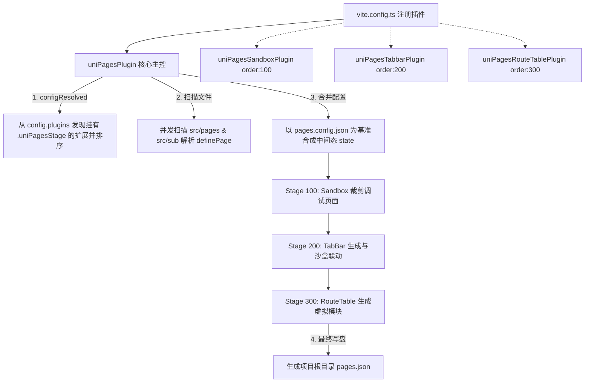

# unibestX Vite 插件集 (plugins/)

本目录收拢了 unibestX 专属的 Vite 构建、编译与开发期辅助插件。所有插件均针对 `uni-app X` + `UTS` 跨端原生编译管线专门设计，提供了从路由自动化、页面容器装配到开发体验优化的全套底层支撑。

---

## 1. 架构设计哲学

本目录遵循 **「物理解耦 + 业务协同」** 的微内核设计哲学：

1. **物理完全解耦（即插即拔）**：
   - 目录下的每个插件都是自包含的独立 `.ts` 模块，**插件之间严禁出现硬编码的交叉代码依赖（无循环 import）**。
   - 任何插件都可以随时在 `vite.config.ts` 的 `plugins: [...]` 数组中注释或拔除，**绝不会引发模块缺失或构建底层崩溃**。
2. **微内核宿主机制（Stage 流水线）**：
   - 庞大复杂的页面路由体系（主包/分包扫描、沙盒单页调试、TabBar 模式、页面路由表生成）不写成数千行的巨型单文件，而是拆分为 **「1 个核心主控 + 3 个卫星扩展」**。
   - 卫星扩展通过标准协议（挂载 `uniPagesStage` 属性）注册到 Vite 插件流水线中，由核心主控在 `configResolved` 阶段动态收集并按 `order` 顺序流水驱动。
3. **单一职责与分层清晰**：
   - **Vite 构建插件**全部集中于此目录；
   - 代码检查插件（如 `eslint-plugin-uts.mjs`）归位在根目录的 `eslint/`，保证构建层与代码规范层边界分明。

---

## 2. 插件全景速查表

| 文件名 | 插件名称 / 导出函数 | 定位与核心功能 | 独立性 (能否拔除) | 宿主 / 数据依赖 |
| :--- | :--- | :--- | :---: | :--- |
| **`pages-json-util.ts`** | *(公共工具模块)* | 平台条件编译过滤（`#ifdef`）、多平台 `pages.json` 解析与合并 | 基础工具 | 无插件依赖，被路由与布局插件共同引用 |
| **`pages-meta-cache.ts`** | *(公共工具模块)* | 完整页面元数据的进程内 + 落盘快照；模式 4 裁剪 Tab 路由后，供 `TabViews` 在多端 dev 进程间恢复多平台 `definePage` 配置 | 基础工具 | 无插件依赖，被页面核心插件与 TabViews 插件共同引用 |
| **`vite-plugin-uni-pages.ts`** | `uniPagesPlugin()` | **路由生成微内核主控**：扫描页面 SFC、解析 `definePage` 宏、合并 `pages.config.json`、调度卫星阶段并写入 `pages.json` | **可拔除** | 依赖 `pages-json-util.ts`；拔除后停止自动路由扫描，退回手动维护 `pages.json` |
| **`vite-plugin-uni-pages-sandbox.ts`** | `uniPagesSandboxPlugin()` | **沙盒独立调试模式（卫星）**：当开启 `VITE_DEV_SANDBOX` 时，将页面路由裁剪为仅调试页面 | **可拔除** | **宿主依赖**：通过 `uniPagesStage (order: 100)` 挂载到核心主控运行；拔除后沙盒裁剪失效 |
| **`vite-plugin-uni-pages-tabbar.ts`** | `uniPagesTabbarPlugin()` | **TabBar 策略注入（卫星）**：根据 `VITE_TABBAR_MODE (0~4)` 动态生成 pages.json 的 tabBar 节点；模式 4 只保留宿主页路由，其余 Tab 页仅作为组件编译 | **可拔除** | **宿主依赖**：通过 `uniPagesStage (order: 200)` 挂载到核心主控运行；拔除后 tabBar 不再动态计算 |
| **`vite-plugin-uni-pages-route-table.ts`** | `uniPagesRouteTablePlugin()` | **页面路由表虚拟模块（卫星）**：在写盘前生成 `virtual:uni-pages-route-table`，按路径 map / 数组 list 两种形态分别导出 JSON 与对象（`useRoute()` 数据源），不产生物理文件 | **可拔除** | **宿主依赖**：通过 `uniPagesStage (order: 300)` 挂载到核心主控运行；拔除后页面配置表停止更新 |
| **`uni-layouts-plugin.ts`** | `uniLayoutsPlugin()` | **跨端 Layout 布局包装**：解析页面 `layout` 配置并在 SFC 模板外层自动包裹布局组件（如 `<layout-default>`） | **可拔除** | **产物消费**：依赖 `pages.json` 数据；拔除后页面不再被包裹布局外壳 |
| **`root-plugin.ts`** | `uniRootX()` | **全局根骨架组件包装**：自动给页面外层套上根组件（如 `<AppRoot>`）并透传页面参数 | **可拔除** | **产物消费**：依赖 `pages.json` 数据；拔除后页面不再包裹全局根组件 |
| **`vite-plugin-tabbar-views.ts`** | `tabbarViewsPlugin()` | **单页 TabBar 调度生成**：根据 `src/tabbar/config.uts` 自动生成 `TabViews.uvue`，普通 Tab 直接复用页面 `.uvue`，宿主页通过 `#tabHost` slot 注入 | **可拔除** | **配置依赖**：依赖 `src/tabbar/config.uts`、`pages.json` 与 `pages-meta-cache.ts` 的跨进程快照；用于单页保活模式 |
| **`vite-plugin-clean-logger.ts`** | `cleanLoggerPlugin()` | **控制台日志净化**：拦截并过滤 Vite / DCloud 编译期的 warning 告警、无意义栈帧与代码片段 | **完全独立** | 无任何外部依赖，即插即拔 |
| **`vite-plugin-editor-version.ts`** | `editorVersionPlugin()` | **编辑器版本对齐检测**：构建前检查本机 HBuilderX 编译器与 `@dcloudio/*` 依赖版本是否一致并给出提示 | **完全独立** | 仅依赖 `scripts/sync-hbuilderx.mjs --preflight`，只提示不阻断 |
| **`vite-plugin-h5-optimize-deps.ts`** | `h5OptimizeDepsPlugin()` | **H5 依赖预构建优化**：将核心大依赖（Pinia 等）纳入 esbuild 预构建，加速 H5 冷启动并规避 504 错误 | **完全独立** | 仅在 H5 / Web 开发模式生效，无其他插件依赖 |
| **`vite-plugin-html-to-uni.ts`** | `htmlToUniPlugin()` | **HTML 标签编译期转 uni 原生组件**：在 `pre` 阶段将 `<template>` 内的 `div`/`b`/`span`/`p`/`img` 等自动转为 `view`/`text`/`image` | **完全独立** | 无任何外部依赖，即插即拔 |

---

## 3. 核心机制详细说明

### 3.1 路由流水线（微内核 + 卫星扩展）

- **为什么卫星插件离开核心无法运行？**
  `sandbox` / `tabbar` 只导出携带 `uniPagesStage` 描述的对象；`route-table` 额外实现了 `resolveId` / `load` 来提供虚拟模块。Vite 不认识 `uniPagesStage`，只有核心主控会在合适时机调用 `stage.run(state)`，因此路由表内容仍由核心扫描结果驱动。
- **为什么核心主控离开卫星依然完好？**
  核心主控在执行前会自检阶段是否完整，若某阶段未注册，仅打印一条警告提示对应功能未生效，核心依然能完成全量页面扫描并输出标准 `pages.json`。
- **模式 4 为什么需要跨进程元数据快照？**
  非宿主 Tab 页会从 `pages.json` 移除，但多端 dev 进程可能同时监听同一份生成物。完整 `definePage` 变体会写入 `unpackage/cache/unibestx-pages-meta.json`，任一进程重新生成 `TabViews.uvue` 时都能恢复正确的平台标题与导航配置，不会被其他端的旧状态覆盖。

---

### 3.2 页面 SFC 模板包装体系

`uni-layouts-plugin.ts` 与 `root-plugin.ts` 均作为 SFC 转换器运行在 Vite 的 `transform` 钩子中：

- **`uni-layouts-plugin.ts`**：
  1. 读取并缓存 `pages.json` 中配置的 `layout`（如 `layout: "default"`）；
  2. 匹配页面 SFC 源码，将 `<template>...</template>` 的内容用 `<layout-${layoutName}>` 包裹；
  3. 支持通过 `definePage({ layout: false })` 针对特定页面禁用布局。
- **`root-plugin.ts` (`uniRootX`)**：
  1. 在布局组件外层进一步包裹统一的根骨架组件（默认路径为 `src/AppRoot.uvue`）；
  2. 从 `pages.json` 读取该页面的自定义参数（如 `showBack`、`hideNavbar`），通过 props 透传给根组件；
  3. 模式 4 下跳过 `TabViews.uvue` 直接复用的 Tab 页面，避免宿主内的 Tab 子页再次挂载 `AppRoot` 并触发重复同步；
  4. ⚠️ **注意**：如果当前工程没有创建 `src/AppRoot.uvue`，且不需要全局根组件包裹功能，请在 `vite.config.ts` 中将 `uniRootX` 注释掉。

---

### 3.3 HTML 标签转 uni 原生组件插件 (`vite-plugin-html-to-uni.ts`)

为了降低 Web 开发者的心智转换成本，并在写页面时保留常用的 HTML 语义化标签习惯，该插件在 Vite `enforce: 'pre'` 阶段拦截并自动转译 `<template>` 内的 HTML 标签：

- **结构与容器标签**：`div`、`p`、`section`、`article`、`aside`、`main`、`header`、`footer`、`nav`、`ul`、`ol`、`li` 自动转换为原生 `<view>`。
- **文本修饰标签**：
  - `<b>`、`<strong>` → `<text class="font-bold">`（加粗文本）
  - `<i>`、`<em>` → `<text class="italic">`（斜体文本）
  - `<s>`、`<del>` → `<text class="line-through">`（中划线/删除线）
  - `<u>` → `<text class="underline">`（下划线文本）
  - `` → `<text>`（行内文本）
- **媒体组件**：`` → `<image>`
- **特性保证**：
  - **智能 Class 合并**：开发者已有 class（如 `class="text-red-500"`）与自动注入的默认类（如 `font-bold`）智能去重合并；
  - **暗黑与动态样式穿透**：原生保留 `:style`、`dark:*` 类名及属性；
  - **精准隔离**：仅在最外层 `<template>` 内做 AST/正则安全替换，不误伤 `<script>` 与 `<style>`。

---

## 4. 常见操作与维护准则

### 4.1 开启 / 禁用某项功能
- **想禁用沙盒调试功能**：在 `vite.config.ts` 中直接移除或注释 `uniPagesSandboxPlugin()`；
- **想使用纯手动维护 pages.json**：设置 `uniPagesPlugin({ enabled: false })`，核心扫描将停止，`pages.json` 完全由开发者手工编写；
- **不使用全局根组件**：注释掉 `uniRootX(...)` 即可，页面恢复常规渲染；
- **排查控制台噪音**：若需排查原生告警被吞掉的问题，可将 `cleanLoggerPlugin({ silenceAll: false })` 设置为 `false`。

### 4.2 编写新插件规范
- 若新增属于**页面路由/页面配置流程**的能力，应遵循卫星扩展协议实现 `uniPagesStage`；
- 若新增属于**代码规范 / Lint 规则**，必须放置在根目录 `eslint/` 或 `stylelint/`，严禁放入本目录。
